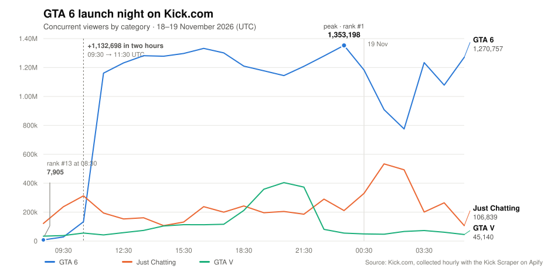

# GTA 6 Launch Night on Kick.com — Hourly Viewership

**Kick.com publishes only the present moment.** Its API tells you how many people are watching a
category *right now*; it keeps no history and offers no archive. So the hour-by-hour shape of the
biggest game launch in history was never recorded by the platform it happened on.

This repository is that record. Twenty-two hourly snapshots of Kick.com taken through the GTA 6
launch, covering **17,763 live-stream observations across 4,141 channels in 51 languages**.

<picture>
  <source media="(prefers-color-scheme: dark)" srcset="chart-dark.svg">
  
</picture>

| | |
|---|---|
| **Start** | 7,905 concurrent viewers — 13th most-watched category on Kick (18 Nov, 08:30 UTC) |
| **Peak** | **1,353,198** concurrent viewers — 1st (18 Nov, 23:30 UTC) |
| **Growth** | 171x in 15 hours |
| **Steepest climb** | +1,132,698 viewers in two hours (09:30 to 11:30 UTC) |
| **Biggest single stream** | RRaenee, 271,680 concurrent viewers |
| **Live GTA 6 streams at once** | up to 899 |
| **Leading language** | **Arabic**, ahead of Portuguese, Turkish and English |

That last row is the finding most likely to surprise you. Measured in viewer-hours across the
launch, GTA 6 on Kick was a bigger Arabic-language and Portuguese-language event than an
English-language one.

---

## What's in here

### `data/gta6_viewers_hourly.csv` — the headline series (23 rows)

One row per snapshot: GTA 6's viewers and rank, with three reference categories alongside.

| Column | Description |
|---|---|
| `snapshot_utc` | When the snapshot was taken (UTC, minute precision) |
| `gta6_viewers` | Concurrent viewers in the `grand-theft-auto-vi` category |
| `gta6_rank` | GTA 6's position among all categories in that snapshot |
| `just_chatting_viewers`, `irl_viewers`, `gta5_viewers`, `slots_viewers` | Reference categories, same instant |
| `top30_total_viewers` | Sum of the 30 largest categories — platform-wide scale |
| `categories_in_snapshot` | How many categories that snapshot ranked |
| `apify_dataset_id` | The source run, so any row can be traced back |

### `data/gta6_streams_hourly.csv` — every GTA 6 stream, every hour (17,763 rows)

The streamer-level table. One row per channel per snapshot.

| Column | Description |
|---|---|
| `snapshot_utc` | Snapshot timestamp (UTC) |
| `rank_in_snapshot` | Position by viewers within that hour |
| `username`, `channel_slug`, `channel_url` | The channel |
| `viewers` | Concurrent viewers on that stream |
| `stream_title` | Title as broadcast — often the clearest signal of language and region |
| `language` | Broadcast language as Kick reports it |
| `is_mature` | Kick's mature-content flag |
| `stream_started_at` | When the broadcast began (Kick's own timestamp, UTC) |
| `livestream_id` | Stable id for one broadcast, so a single stream can be followed across hours |
| `apify_dataset_id` | Source run |

### `data/kick_categories_hourly.csv` — the whole platform (715 rows)

Every ranked category in every snapshot — 89 distinct categories. This is the context that makes
the GTA 6 number mean something: what it displaced, and by how much.

| Column | Description |
|---|---|
| `snapshot_utc` | Snapshot timestamp (UTC) |
| `rank` | Position by viewers in that snapshot |
| `category`, `category_slug`, `category_url` | The category |
| `viewers` | Concurrent viewers |
| `parent_category` | Kick's grouping (for example `IRL`, `Games`) |
| `is_mature` | Mature-content flag |
| `apify_dataset_id` | Source run |

---

## Where this came from

Every row was collected from Kick.com's own public endpoints by the
**[Kick Scraper](https://apify.com/bhole_krishna/kick-scraper)** on Apify, running on an hourly
schedule through the launch. No login, no private API, nothing behind a paywall.

### Collect the next one yourself

The data stops at 19 November 05:30 UTC because that is when this snapshot of the repository was
cut. Kick keeps no history, so **the only way to get the hours after that is to have been
collecting them** — or to start now. The actor that produced every column above is public:

**[apify.com/bhole_krishna/kick-scraper](https://apify.com/bhole_krishna/kick-scraper)**

The exact input behind `gta6_streams_hourly.csv`:

```json
{
  "categories": ["grand-theft-auto-vi"],
  "scrapeLiveStreams": true,
  "maxItems": 1000
}
```

And behind `kick_categories_hourly.csv`:

```json
{
  "scrapeCategories": true,
  "maxItems": 30
}
```

Put either on an hourly schedule and you are building the same record for whatever launches next.
The actor also returns past broadcasts with working VOD links, the most-viewed clips by view count
or by date, channel profiles with follower counts and socials, and all 18,000+ Kick categories
ranked by live viewers.

---

## On Kaggle

The same three tables are published as a Kaggle dataset, with the notebook below attached and run:

- **Dataset:** <https://www.kaggle.com/datasets/krishnadubeyyy/gta-6-launch-night-kick-hourly-viewership>
- **Notebook:** <https://www.kaggle.com/code/krishnadubeyyy/gta-6-launch-night-on-kick-reading-the-curve>

---

## Starter notebook

[`notebooks/gta6-launch-curve.ipynb`](notebooks/gta6-launch-curve.ipynb) loads all three tables and
answers four questions: what the curve looked like, the hour GTA 6 overtook Just Chatting, which
language the launch was actually in, and whether a few huge streamers or the long tail held the
1.35 million. It finds its input files by name rather than by a hard-coded path, so it runs
unchanged on Kaggle or locally.

The short answer to the fourth question: at peak, the single biggest stream held **6.5%** of the
audience and the top ten held **31.5%**. No streamer carried this — 856 of them did.

---

## Honest notes on the data

Things a careful analyst should know before publishing a number from this.

**Snapshots are instants, not averages.** Each row is one reading of a live counter. Concurrent
viewers swing minute to minute; a peak that fell between two snapshots is not in this data.

**The hourly series starts at 08:30 UTC.** `gta6_viewers_hourly.csv` also holds a 07:48 reading
from the run that set the schedule up. The chart plots only the 22 on-the-hour snapshots so the
spacing is even; the extra row is kept because deleting collected data to tidy a series is the
wrong instinct.

**Stream rows are deduplicated by channel.** Kick's paginated stream listing can return the same
channel on more than one page while the list reorders underneath the reader. Where that happened,
the highest viewer count for that channel in that snapshot was kept. The effect was small in
steady state (2–8 rows an hour) and large during the launch surge (205 of 919 rows at 10:30),
which is exactly when the listing was churning fastest.

**Summed streams land 0–4% under the category total.** Adding up every stream in an hour gives
slightly less than that hour's category figure. Two reasons: the two numbers are read seconds
apart, and the stream listing does not reach the smallest streams in the long tail. The gap is
reported rather than smoothed — it is the honest error bar on this data, and it widens to 4.4% in
the final hour.

**`stream_started_at` is Kick's timestamp, not ours.** It arrives without an explicit zone and is
treated as UTC.

**Language is self-declared.** It is the channel's own setting, not detected from audio, so the
language totals describe how streamers label themselves.

---

## Licence and citation

The data is released under [CC BY 4.0](LICENSE) — use it commercially, publish from it, build on
it; just credit the source.

> GTA 6 Launch Night on Kick.com — Hourly Viewership (2026). Collected from Kick.com with the
> Kick Scraper on Apify. https://apify.com/bhole_krishna/kick-scraper

`make_chart.py` regenerates both chart files from the CSVs, with no third-party libraries:

```bash
python make_chart.py
```
